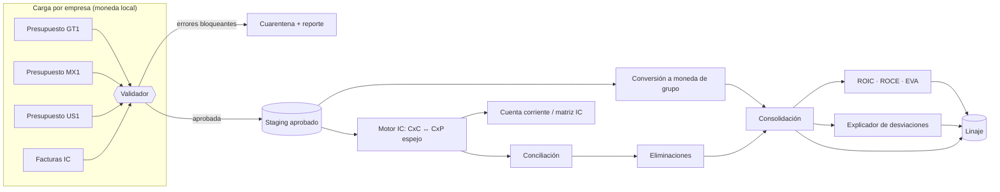
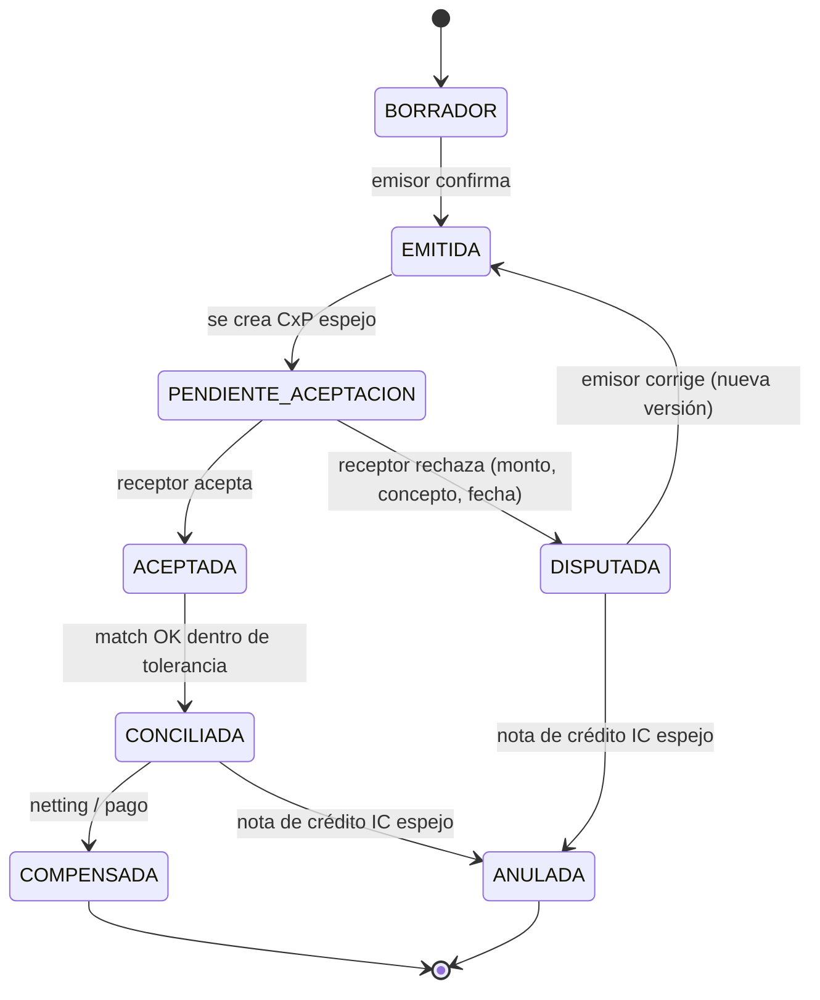
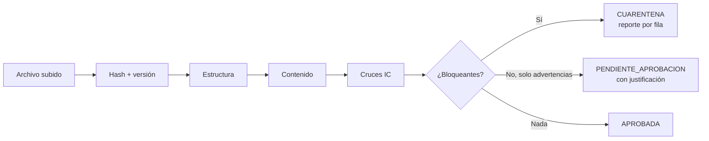

# Consolidación Intercompany de Presupuesto Multimoneda
### Especificación funcional y técnica — Motor IC, Conciliación, Validador, Explicador y KPIs calculados

> **Reto:** *¿Cómo logramos que el presupuesto de un grupo se consolide solo, en una moneda y sin capturas manuales, y que cada cifra se explique sola?*
>
> **Alcance:** 6 empresas, 3 monedas, transacciones entre empresas del grupo (ventas, servicios, préstamos), presupuesto por país en moneda local, datos ficticios con errores sembrados.
>
> **Stack propuesto:** Supabase (PostgreSQL + funciones + RLS) · React (web) · Claude API solo para **redactar** explicaciones sobre cifras ya calculadas (nunca para calcular).

---

## 0. Principios de diseño (no negociables)

| # | Principio | Consecuencia práctica |
|---|-----------|----------------------|
| P1 | **Un registro, una verdad.** Toda cifra del grupo es una consulta, no una captura. | No existe ninguna tabla donde un usuario escriba un total, un ROIC o un saldo consolidado. |
| P2 | **Toda transacción IC nace en pareja.** | Una factura IC emitida genera automáticamente su CxC en el emisor **y** su CxP espejo en el receptor. Si una de las dos patas falta, el sistema lo sabe. |
| P3 | **Se concilia en moneda de transacción, se elimina en moneda de grupo.** | Las diferencias por tipo de cambio quedan aisladas y clasificadas; nunca se "esconden" en la eliminación. |
| P4 | **Nada entra al número del grupo sin pasar el validador.** | Cargas con errores bloqueantes quedan en cuarentena; el consolidado solo lee cargas `APROBADA`. |
| P5 | **Linaje completo.** | Cada cifra consolidada guarda los IDs de los registros origen, la tasa usada y las eliminaciones aplicadas. Click → registro origen. |
| P6 | **La IA explica, no calcula.** | Los números y las causas los produce SQL determinístico; el LLM solo convierte el resultado estructurado a lenguaje de director, citando IDs. |

---

## 1. Problemas a resolver → componente que lo resuelve

| Problema planteado | Componente | Sección |
|---|---|---|
| 1. Saber cuánto le facturé a cada empresa, cuánto me facturó y el saldo neto | **Cuenta Corriente IC** (CxC/CxP IC + matriz de saldos) | §4, §5 |
| 2. Que la venta a una empresa del grupo no se cuente doble | **Motor de consolidación + eliminaciones** | §6 |
| 3. ROIC, ROCE y EVA no copiados a mano | **Tablero de KPIs calculados con árbol de cálculo** | §8 |
| 4. Cada país presupuesta en su moneda | **Modelo multimoneda con tasas de grupo versionadas** | §3 |
| 5. Nadie explica rápido por qué cambió una cifra | **Explicador de desviaciones (bridge)** | §9 |
| Errores sembrados | **Validador de carga** | §7 |

---

## 2. Modelo conceptual



### 2.1 Entidades principales

| Entidad | Descripción | Claves |
|---|---|---|
| `empresa` | Las 6 empresas del grupo. Cada una es **a la vez** cliente y proveedor potencial de las demás. | `empresa_id`, `pais`, `moneda_funcional`, `tasa_isr`, `activa` |
| `socio_ic` | Vista/registro que expone cada empresa del grupo como cliente y como proveedor dentro del maestro de terceros. Marca `es_intercompany = true`. | `tercero_id` ↔ `empresa_id` |
| `moneda` | GTQ, MXN, USD (o las 3 del dataset). | `moneda_id`, `decimales` |
| `tasa_grupo` | Tabla única de tasas del grupo, versionada por escenario. | `escenario`, `periodo`, `moneda`, `tipo_tasa` (PRESUPUESTO / PROMEDIO / CIERRE / HISTORICA), `tasa_a_usd` |
| `cuenta_grupo` | Plan de cuentas homologado del grupo (P&L y Balance), con marca de cuenta IC. | `cuenta_grupo_id`, `tipo`, `es_ic`, `cuenta_contraparte_ic` |
| `mapeo_cuenta` | Cuenta local de cada empresa → cuenta de grupo. | `empresa_id`, `cuenta_local`, `cuenta_grupo_id` |
| `carga` | Cada archivo/lote subido. Tiene hash, estado, versión. | `carga_id`, `empresa_id`, `escenario`, `version`, `hash`, `estado` |
| `linea_presupuesto` | Detalle de presupuesto en moneda local. | `linea_id`, `carga_id`, `periodo`, `cuenta_local`, `monto_local`, `socio_ic_id?`, `driver_volumen?`, `driver_precio?` |
| `documento_ic` | Factura / nota de crédito / préstamo IC (real) o **acuerdo IC** (presupuesto). | `doc_ic_id`, `emisor`, `receptor`, `moneda_tx`, `monto_tx`, `fecha`, `estado` |
| `cxc_ic` | Pata CxC en el emisor. | `cxc_id`, `doc_ic_id` |
| `cxp_ic` | Pata CxP espejo en el receptor. | `cxp_id`, `doc_ic_id` |
| `conciliacion_ic` | Resultado del match por documento y por par de empresas. | `conc_id`, `doc_ic_id`, `estado`, `diferencia`, `tipo_diferencia` |
| `eliminacion` | Asientos de eliminación generados (nunca manuales). | `elim_id`, `regla`, `doc_ic_id[]`, `monto_usd` |
| `linaje` | Relación cifra consolidada → registros origen. | `cifra_id`, `origen_tipo`, `origen_id`, `factor`, `tasa`, `monto_aporte` |
| `hallazgo_validacion` | Error/advertencia encontrado por el validador. | `hallazgo_id`, `carga_id`, `regla`, `severidad`, `registro_id`, `mensaje` |

---

## 3. Multimoneda: cómo cada país presupuesta en su moneda

### 3.1 Tres monedas, tres roles

| Rol | Definición | Ejemplo |
|---|---|---|
| **Moneda de transacción** | En la que se emitió la factura/acuerdo IC. | GT1 factura a MX1 en USD |
| **Moneda funcional** | En la que cada empresa presupuesta y lleva libros. | GT1 → GTQ, MX1 → MXN |
| **Moneda de presentación (grupo)** | En la que se consolida. | USD |

### 3.2 Reglas de conversión

| Tipo de cifra | Tasa que se usa | Por qué |
|---|---|---|
| P&L presupuesto | `PRESUPUESTO` del periodo (tasa fija del escenario) | Aísla el efecto cambiario del desempeño operativo |
| P&L real | `PROMEDIO` del periodo | Estándar IAS 21 / ASC 830 |
| Balance (activos, pasivos) | `CIERRE` del periodo | Estándar |
| Patrimonio | `HISTORICA` | Estándar |
| Diferencia resultante | Cuenta **CTA** (Ajuste acumulado por conversión) en patrimonio | El balance consolidado cuadra sin forzar |

**Reglas duras:**
- La tabla `tasa_grupo` es **única para todo el grupo**. Ningún país carga su propia tasa para consolidar. (Pueden presupuestar con la suya, pero el grupo convierte con la del grupo).
- Todas las tasas se expresan `1 unidad de moneda = X USD` y el validador verifica rangos plausibles (detecta tasas invertidas: 7.80 en vez de 0.1282).
- Comparar presupuesto vs real se hace **dos veces**: a tasa de presupuesto (desempeño puro) y a tasa real (impacto total). La diferencia es el **efecto cambiario**, que el explicador reporta por separado.

### 3.3 Ejemplo numérico (ilustrativo)

| Concepto | Valor |
|---|---|
| GT1 (GTQ) vende servicios a MX1 (MXN), factura en **GTQ 780,000** | |
| Tasa de grupo GTQ→USD (presupuesto) | 0.128205 |
| Tasa de grupo MXN→USD (presupuesto) | 0.055556 |
| CxC en GT1: GTQ 780,000 → **USD 100,000** | |
| CxP en MX1: registrada en moneda tx GTQ 780,000; en su funcional MXN 1,800,000 (con su tasa local) | |
| Conversión de MX1 a grupo vía GTQ (moneda tx) → **USD 100,000** → elimina en cero | ✅ |
| Si MX1 solo tuviera el monto en MXN y su tasa local difiere: MXN 1,800,000 × 0.055556 = USD 100,000.80 → diferencia USD 0.80 | se clasifica como **diferencia FX**, no como error |

> **Por eso cada CxP espejo guarda siempre el monto en moneda de transacción.** Es lo que permite eliminar sin diferencias artificiales.

---

## 4. Motor Intercompany: CxC + CxP espejo

### 4.1 Idea central

Cuando una empresa del grupo emite una factura a otra:

1. En el **emisor** se crea una **CxC** con las condiciones de un cliente normal (plazo, moneda, impuestos), pero el cliente es un `socio_ic`.
2. En el **receptor** se crea automáticamente una **CxP espejo**: "tengo una factura por pagar a un proveedor", pero el proveedor es un `socio_ic`.
3. Ambas patas comparten el mismo `doc_ic_id`. Esa es la **llave de conciliación**; no se concilia por monto ni por texto.
4. Ambas alimentan la **cuenta corriente IC** entre el par de empresas.

### 4.2 Diagrama de estados del documento IC



### 4.3 Comportamiento implícito (lo obvio que el sistema debe hacer)

| Situación | Comportamiento |
|---|---|
| Emisor corrige una factura disputada | Se crea **nueva versión** del `doc_ic`; la versión anterior queda inmutable y referenciada. La CxP espejo se actualiza a la nueva versión y vuelve a `PENDIENTE_ACEPTACION`. |
| Anulación | Nunca se borra. Se emite **nota de crédito IC**, que genera su propia pata espejo (CxC negativa / CxP negativa). |
| Receptor intenta crear una CxP IC manual sin `doc_ic_id` | Bloqueado. Una CxP con proveedor `es_intercompany` solo puede nacer del espejo. (Excepción configurable: "IC entrante de sistema externo" con match posterior obligatorio). |
| Pago parcial | El pago IC también nace en pareja (cobro en emisor ↔ pago en receptor), ligado al `doc_ic_id`. |
| Compensación (netting) | Proceso mensual que cruza saldos A↔B y genera documento de compensación espejo en ambos lados. |
| Documentos vinculados | Contrato IC / política de precios de transferencia → se adjunta al `doc_ic` y se hereda en la CxP espejo. |
| Cierre de periodo | Un periodo no se puede cerrar en una empresa con IC `PENDIENTE_ACEPTACION` o `DISPUTADA` de ese periodo (o requiere aprobación explícita con motivo, que queda en linaje). |
| Presupuesto | Lo mismo aplica a **acuerdos IC presupuestados**: si GT1 presupuesta vender 100k a MX1, MX1 debe tener el costo IC espejo de GT1. El sistema genera la línea espejo como **propuesta** y el validador marca la diferencia si MX1 cargó otro número. |

### 4.4 Precios de transferencia (anticipado)

Cada `doc_ic` puede llevar `politica_tp_id` (costo + margen %, precio de mercado, etc.). El validador alerta si el margen aplicado se sale del rango de la política — esto es lo que un auditor fiscal preguntará primero.

---

## 5. Cuenta Corriente IC y Conciliación

### 5.1 La matriz IC (respuesta directa al punto 1)

Para cada par de empresas (A, B) y periodo:

| Métrica | Fórmula |
|---|---|
| Facturado A → B | Σ `cxc_ic` de A con receptor B |
| Facturado B → A | Σ `cxc_ic` de B con receptor A |
| Cobrado / pagado | Σ pagos IC |
| **Saldo neto A vs B** | (CxC A→B − cobros) − (CxP A←B − pagos) |
| Saldo visto por B | El mismo cálculo desde B — **debe ser el espejo exacto** |
| **Diferencia de conciliación** | Saldo A + Saldo B (en moneda tx) ≠ 0 → hallazgo |

Vista en pantalla: **matriz 6×6** (emisor en filas, receptor en columnas), celda = saldo en USD, color por estado de conciliación. Click en celda → lista de documentos → click en documento → ambas patas lado a lado.

### 5.2 Reglas de conciliación (orden de ejecución)

| Nivel | Criterio | Resultado |
|---|---|---|
| N1 — Documento | Mismo `doc_ic_id`, misma versión, mismo monto en moneda tx | `CONCILIADO` |
| N2 — Documento con diferencia FX | Mismo `doc_ic_id`, monto tx igual, diferencia solo en moneda funcional/grupo ≤ tolerancia | `CONCILIADO_FX` → diferencia a cuenta de diferencial cambiario IC |
| N3 — Documento con diferencia real | Mismo `doc_ic_id`, monto tx distinto | `DIFERENCIA_MONTO` (hallazgo) |
| N4 — Pata huérfana | CxC sin CxP espejo o viceversa | `SIN_CONTRAPARTE` (hallazgo) |
| N5 — Corte | Emisor en periodo P, receptor en P+1 | `DIFERENCIA_CORTE` (hallazgo, se explica, puede ser válido) |
| N6 — Saldo de par | Σ saldos A↔B ≠ 0 después de N1–N5 | `SALDO_NO_CUADRA` |

**Tolerancia FX:** configurable por grupo (ej. ≤ USD 50 por documento o ≤ 0.1 %). Fuera de tolerancia = hallazgo, aunque sea FX.

### 5.3 Tipos de diferencia (catálogo)

`FX` · `MONTO` · `CORTE` · `SIN_CONTRAPARTE` · `DUPLICADO` · `MONEDA_ERRONEA` · `CUENTA_NO_IC` (la transacción es IC pero se mapeó a cuenta de terceros) · `CONTRAPARTE_ERRONEA` (A dice que vendió a B, pero C tiene la CxP).

---

## 6. Motor de Consolidación (punto 2: no contar doble)

### 6.1 Pasos (pipeline determinístico)

| Paso | Acción | Salida |
|---|---|---|
| 1 | Tomar solo cargas `APROBADA` de la versión activa del escenario | Staging |
| 2 | Mapear cuentas locales → cuentas de grupo | Líneas homologadas |
| 3 | Convertir a USD con `tasa_grupo` según §3.2 | Líneas en USD + CTA |
| 4 | **Agregar** (suma simple de las 6 empresas) | "Agregado" — esto SÍ cuenta doble |
| 5 | **Eliminar** con reglas (tabla abajo) | Asientos de eliminación con `doc_ic_id` |
| 6 | Consolidado = Agregado − Eliminaciones | Estados consolidados |
| 7 | Escribir linaje de cada cifra | Trazabilidad |

### 6.2 Reglas de eliminación

| Regla | Débito | Crédito | Fuente |
|---|---|---|---|
| E1 Ventas IC | Ingresos IC (emisor) | Costo/gasto IC (receptor) | `doc_ic` conciliados |
| E2 Saldos IC | CxP IC (receptor) | CxC IC (emisor) | Cuenta corriente al cierre |
| E3 Préstamos IC | Préstamo por pagar IC | Préstamo por cobrar IC | `doc_ic` tipo préstamo |
| E4 Intereses IC | Ingreso financiero IC | Gasto financiero IC | Idem |
| E5 Dividendos IC | Ingreso por dividendos | Patrimonio / dividendos decretados | Idem |
| E6 Margen no realizado (opcional, fase 2) | Costo de ventas | Inventario | Inventario de origen IC al cierre × margen |
| E7 Diferencia FX IC | Diferencial cambiario IC | CTA / resultado | Residual de N2 |

**Regla de oro:** la eliminación se calcula sobre **la pata del emisor** (ingreso) y se verifica contra la pata del receptor. Si no cuadran, se elimina el monto conciliado y **la diferencia queda visible** en una línea "IC no conciliado" — nunca se fuerza a cero.

### 6.3 Ejemplo

| | GT1 | MX1 | Agregado | Eliminación | **Consolidado** |
|---|---|---|---|---|---|
| Ventas a terceros | 500,000 | 800,000 | 1,300,000 | — | 1,300,000 |
| Ventas IC (GT1→MX1) | 100,000 | — | 100,000 | (100,000) | 0 |
| **Ventas totales** | 600,000 | 800,000 | **1,400,000** | (100,000) | **1,300,000** |
| Costo IC (MX1 compra a GT1) | — | 100,000 | 100,000 | (100,000) | 0 |

Sin la eliminación, el grupo reportaría **USD 1.4M en vez de 1.3M** — 7.7 % de ventas infladas. Ese es el número que el demo debe mostrar.

---

## 7. Validador de Carga (frenar el error antes de entrar)

### 7.1 Flujo



### 7.2 Catálogo de reglas

Severidad: **B** = bloqueante · **A** = advertencia (requiere justificación) · **I** = informativa.

| Código | Regla | Sev. | Error sembrado que atrapa |
|---|---|---|---|
| V01 | Columnas, tipos y formato de periodo correctos | B | Archivo mal formado |
| V02 | La moneda declarada en la carga = moneda funcional de la empresa | B | GT1 cargando en MXN |
| V03 | Toda cuenta local tiene mapeo a cuenta de grupo | B | Cuenta nueva sin mapear (se perdería del consolidado) |
| V04 | No hay filas duplicadas (empresa+periodo+cuenta+socio) | B | Línea duplicada |
| V05 | Los 12 periodos presentes (o los del escenario) | B | Mes faltante |
| V06 | Balance cuadra: Activo = Pasivo + Patrimonio por periodo | B | Balance descuadrado |
| V07 | Signos por naturaleza de cuenta (ingreso +, gasto −, o convención definida) | B | Signo invertido |
| V08 | Tasa de cambio dentro de banda plausible (±X % vs periodo anterior y vs referencia) | B | **Tasa invertida** (7.80 vs 0.128) |
| V09 | Escala: variación vs histórico/periodo previo > 10× | A | **Error de miles** (cargó en miles vs unidades) |
| V10 | Línea en cuenta IC sin `socio_ic` | B | IC "anónimo" que no se puede eliminar |
| V11 | `socio_ic` = la misma empresa | B | Autofacturación |
| V12 | Venta IC presupuestada A→B ≠ compra IC B←A (en moneda tx) | B/A según tolerancia | **IC asimétrico** — fuente principal de doble conteo |
| V13 | Transacción con tercero que en realidad es empresa del grupo (por NIT/RFC/EIN) | B | **Venta IC registrada como venta a tercero** |
| V14 | Margen IC fuera de la política de precios de transferencia | A | Precio IC irreal |
| V15 | Outlier estadístico por cuenta (z-score > 3 vs serie) | A | Número "dedazo" |
| V16 | Subtotales del archivo = suma de su detalle | B | Totales que no suman (Excel con fórmula rota) |
| V17 | Capital invertido calculado ≤ 0 o NOPAT con tasa de impuesto fuera de rango | A | Insumos inválidos para KPIs |
| V18 | Fecha de documento IC fuera del periodo de carga | A | Corte |
| V19 | Mismo hash de archivo ya cargado | I | Recarga accidental |
| V20 | Diferencia cambiaria de un documento IC fuera de tolerancia (USD o %) | A | Tasa local del receptor desactualizada |

> Implementadas en el motor de referencia: V01–V14, V18 y V20. V15–V17 y V19 quedan para iteraciones posteriores.

### 7.3 Salida del validador

Por cada hallazgo: `regla`, `severidad`, `empresa`, `fila/registro_id`, `valor encontrado`, `valor esperado`, `sugerencia`, `impacto estimado en USD en el consolidado`. Se muestra ordenado por **impacto en el número del grupo**, no por número de fila — el director ve primero lo que más mueve.

---

## 8. Tablero ROIC · ROCE · EVA (calculados, no copiados)

### 8.1 Definiciones (fijas, documentadas en el sistema)

| KPI | Fórmula | Insumos (todos desde el consolidado) |
|---|---|---|
| **NOPAT** | EBIT × (1 − t) | EBIT consolidado; `t` = tasa efectiva ponderada por EBIT de cada país (o tasa de grupo definida) |
| **Capital invertido** | Capital de trabajo operativo neto + Activo fijo neto + Intangibles operativos  *(equivalente: Deuda financiera neta + Patrimonio)* | Balance consolidado **después** de eliminar saldos IC |
| **ROIC** | NOPAT / Capital invertido promedio | |
| **Capital empleado** | Activo total − Pasivo corriente | Balance consolidado |
| **ROCE** | EBIT / Capital empleado promedio | |
| **EVA** | NOPAT − (WACC × Capital invertido promedio) | WACC = parámetro versionado del grupo |

> Por qué importa la eliminación aquí: sin eliminar, las **ventas** se inflan (en el dataset: USD 13.94M vs 12.94M) y el **capital empleado** también, porque el activo incluye préstamos y CxC IC que el pasivo corriente no compensa (USD 20.45M vs 18.45M → ROCE 11.5 % vs 12.8 %). El capital de trabajo IC solo se neutraliza solo si **ambas patas** están bien registradas; con una pata faltante (error E04) también se distorsiona. El tablero lo demuestra mostrando el KPI "antes" y "después" de eliminaciones.

### 8.2 Reglas de implementación

- Los KPIs son **vistas SQL** (`v_kpi_grupo`, `v_kpi_empresa`), no columnas editables.
- WACC y tasas de impuesto son **parámetros** con vigencia y autor; cambiar uno genera nueva versión y el explicador lo reporta como causa.
- Cada KPI expone su **árbol de cálculo**: ROIC → NOPAT (EBIT, t) / Capital invertido (CTO, AF, …) → cada nodo → líneas consolidadas → líneas por empresa → registro origen.
- Se calcula por empresa (stand-alone, en USD) y por grupo — así se ve qué empresa destruye valor (EVA < 0).

### 8.3 Ejemplo de árbol

```
ROIC grupo = 12.4 %
├── NOPAT = 3,720,000 USD
│   ├── EBIT consolidado = 4,960,000
│   │   ├── GT1 1,200,000 (GTQ 9,360,000 × 0.128205) → carga #C-031 líneas 14–22
│   │   ├── MX1 2,100,000 ...
│   │   └── Eliminación E1 margen IC ... → doc_ic IC-2026-0045
│   └── t efectiva = 25.0 % (parámetro P-TAX v3)
└── Capital invertido promedio = 30,000,000
    ├── CTO neto 8,000,000 (después de E2: −1,250,000 CxC/CxP IC)
    └── Activo fijo neto 22,000,000
```

---

## 9. Explicador de Desviaciones (punto 5)

### 9.1 Qué compara

Cualquier par: **Presupuesto V1 vs V2**, **Presupuesto vs Real**, **Mes vs mes**, **Año vs año**.

### 9.2 Descomposición (bridge / cascada) — determinística

Para cada cifra que cambió, el sistema descompone la variación en efectos que suman exactamente la diferencia:

| Efecto | Cálculo | Ejemplo de lectura |
|---|---|---|
| **Tipo de cambio** | Cifra nueva en local × (tasa nueva − tasa anterior) | "−USD 180k porque el MXN se depreció 4 %" |
| **Volumen** | (Vol nuevo − Vol anterior) × Precio anterior | "+USD 300k por 2,000 m² adicionales en MX1" |
| **Precio** | (Precio nuevo − Precio anterior) × Vol nuevo | "−USD 50k por descuento en GT2" |
| **Perímetro / IC** | Cambio en eliminaciones | "−USD 100k: la venta GT1→MX1 ahora se elimina (antes se registró como tercero)" |
| **Corrección de carga** | Diferencia entre versiones de carga de la misma empresa | "+USD 900k: US1 corrigió error de escala (carga #C-044 reemplaza #C-039)" |
| **Parámetro** | Cambio de WACC, tasa ISR, política | "EVA −USD 60k por WACC 10 %→11 %" |
| **Residual** | Lo que no cae en lo anterior | Debe ser ~0; si no, se marca |

Volumen/precio requieren que la línea de presupuesto traiga drivers (`driver_volumen`, `driver_precio`). Si no los trae, ese efecto se reporta como "operativo (sin driver)".

### 9.3 Salida para el director

1. **Cascada visual**: Cifra anterior → efectos → cifra nueva.
2. **Top 5 causas** ordenadas por impacto absoluto, cada una con: *qué cambió, dónde (empresa/cuenta), cuánto, por qué (efecto), registro origen (link)*.
3. **Texto en lenguaje natural** generado por Claude **a partir del JSON del bridge**, con regla: el prompt prohíbe introducir cifras que no estén en el JSON y exige citar el ID de cada causa. Un post-validador compara cada número del texto contra el JSON; si alguno no coincide, se descarta el texto y se muestra solo la tabla.

Ejemplo de salida:

> **Ventas consolidadas bajaron USD 280k vs V1 (−2.1 %).**
> 1. −USD 180k por tipo de cambio: el MXN pasó de 0.0556 a 0.0534 (MX1, MX2). [FX-2026-11]
> 2. −USD 100k por eliminación IC: la venta GT1→MX1 estaba registrada como cliente tercero en V1. [IC-2026-0045, V13]
> 3. ±0 en volumen y precio: la operación no cambió.

---

## 10. Linaje y Auditoría (cada cifra se rastrea sola)

- Tabla `linaje(cifra_id, origen_tipo, origen_id, tasa, factor, monto_aporte)` poblada en cada corrida.
- Toda corrida de consolidación es una **versión inmutable** (`corrida_id`, timestamp, cargas incluidas, versión de tasas, versión de parámetros).
- Drill-down estándar en UI: **KPI → línea consolidada → empresa → línea de carga → fila del archivo original** (con número de fila y hash del archivo).
- Bitácora: quién subió, quién aprobó advertencias y con qué justificación, quién aceptó/disputó cada IC.
- Prueba de integridad automática por corrida: Σ aportes del linaje = cifra consolidada (si no, la corrida falla).

---

## 11. Modelo de datos (Supabase / PostgreSQL) — núcleo

```sql
create table empresa (
  empresa_id      text primary key,          -- 'GT1','MX1','US1'...
  nombre          text not null,
  pais            text not null,
  moneda_funcional text not null references moneda(moneda_id),
  identificador_fiscal text unique,          -- NIT/RFC/EIN: usado por V13
  tasa_isr        numeric(5,4) not null
);

create table tasa_grupo (
  escenario  text, periodo date, moneda_id text, tipo_tasa text
             check (tipo_tasa in ('PRESUPUESTO','PROMEDIO','CIERRE','HISTORICA')),
  tasa_a_usd numeric(18,8) not null check (tasa_a_usd > 0),
  version    int not null,
  primary key (escenario, periodo, moneda_id, tipo_tasa, version)
);

create table cuenta_grupo (
  cuenta_grupo_id text primary key,
  nombre text, tipo text check (tipo in ('ING','GAS','ACT','PAS','PAT')),
  rubro_kpi text,                 -- 'EBIT','CTO','AF','DEUDA'... alimenta KPIs
  es_ic boolean default false,
  cuenta_contraparte_ic text references cuenta_grupo(cuenta_grupo_id)
);

create table carga (
  carga_id uuid primary key default gen_random_uuid(),
  empresa_id text references empresa, escenario text, version int,
  archivo_hash text, estado text check (estado in
    ('RECIBIDA','CUARENTENA','PENDIENTE_APROBACION','APROBADA','REEMPLAZADA')),
  subida_por uuid, subida_en timestamptz default now()
);

create table linea_presupuesto (
  linea_id uuid primary key default gen_random_uuid(),
  carga_id uuid references carga, fila_origen int,
  periodo date, cuenta_local text, monto_local numeric(18,2),
  socio_ic text references empresa(empresa_id),
  driver_volumen numeric, driver_precio numeric
);

create table documento_ic (
  doc_ic_id text, version int default 1,
  tipo text check (tipo in ('FACTURA','NC','PRESTAMO','INTERES','DIVIDENDO','ACUERDO_PPTO')),
  emisor text references empresa, receptor text references empresa,
  moneda_tx text, monto_tx numeric(18,2), fecha date, periodo date,
  politica_tp_id text,
  estado text, primary key (doc_ic_id, version),
  check (emisor <> receptor)
);

create table cxc_ic ( cxc_id uuid primary key default gen_random_uuid(),
  doc_ic_id text, version int, empresa_id text, monto_tx numeric(18,2),
  monto_funcional numeric(18,2), saldo_tx numeric(18,2),
  foreign key (doc_ic_id, version) references documento_ic );

create table cxp_ic ( cxp_id uuid primary key default gen_random_uuid(),
  doc_ic_id text, version int, empresa_id text, monto_tx numeric(18,2),
  monto_funcional numeric(18,2), saldo_tx numeric(18,2),
  aceptada_por uuid, aceptada_en timestamptz,
  foreign key (doc_ic_id, version) references documento_ic );

-- Trigger: al pasar documento_ic a EMITIDA → insertar cxc_ic (emisor) y cxp_ic (receptor)
-- Vista: v_cuenta_corriente_ic (matriz N×N), v_conciliacion_ic, v_consolidado, v_kpi_grupo
```

Seguridad (RLS): cada usuario de país ve/carga solo su empresa; ve las CxP espejo que le llegan; solo el rol `CONTROLLER_GRUPO` ve la matriz completa y aprueba advertencias.

---

## 12. Pantallas (mínimas para el demo)

| # | Pantalla | Qué responde |
|---|---|---|
| 1 | **Carga y validación** | ¿Mi archivo entra? ¿Qué está mal y cuánto mueve? |
| 2 | **Matriz IC 6×6** | ¿Cuánto le facturé a quién, cuánto me facturó, cuál es el saldo, qué no cuadra? |
| 3 | **Bandeja IC del receptor** | Facturas IC por aceptar/disputar |
| 4 | **Consolidado** | Agregado vs Eliminaciones vs Consolidado, en USD, con drill-down |
| 5 | **KPIs** | ROIC/ROCE/EVA grupo y por empresa, antes/después de eliminaciones, árbol de cálculo |
| 6 | **Explicador** | Cascada + top causas + texto, comparando dos versiones |

Diseño: una cifra grande por tarjeta, todo clickeable hasta el registro origen, sin gráficos decorativos.

---

## 13. Guion del demo (lo que debe probar)

| Min | Acción | Prueba |
|---|---|---|
| 0–1 | Subir las 6 cargas del dataset | Funciona con los datos dados |
| 1–3 | Validador muestra hallazgos ordenados por impacto: tasa invertida, error de escala, IC asimétrico, venta IC como tercero, cuenta sin mapear, duplicado… | **Encuentra los errores sembrados** |
| 3–4 | Corregir (o aceptar corrección sugerida) → recarga V2 → aprobada | El error se frena antes del número del grupo |
| 4–5 | Matriz IC: saldo GT1↔MX1, click → documentos → ambas patas | Punto 1 resuelto |
| 5–6 | Consolidado: ventas agregadas USD 13.94M → eliminación −1.0M → **12.94M** (dataset de prueba) | **Sin doble conteo** |
| 6–7 | ROIC antes/después de eliminaciones; click en ROIC → árbol → fila del archivo | KPIs calculados, auditables |
| 7–8 | Explicador V1 vs V2: "bajó 280k: 180k FX, 100k IC reclasificado" con links | **Un director lo entiende sin ayuda** |

**Checklist de aceptación:**
- [ ] 100 % de errores sembrados detectados (lista cruzada con el dataset)
- [ ] Consolidado = Agregado − Eliminaciones, con prueba de integridad del linaje = OK
- [ ] Matriz IC: saldo A→B = −saldo B→A para todos los pares conciliados
- [ ] Ninguna cifra de KPI almacenada como valor capturado
- [ ] Cada número del texto del explicador existe en el JSON del bridge
- [ ] Cualquier cifra en pantalla llega al registro origen en ≤ 4 clicks

---

## 14. Referencia enterprise (solución del reto vs SAP, Primavera P6, Procore, Aconex)

| Capacidad | SAP S/4HANA (Group Reporting + Intercompany Matching & Reconciliation) | Oracle Primavera P6 | Procore | Aconex | **Propuesta** |
|---|---|---|---|---|---|
| Consolidación multimoneda | ✅ Completa (conversión, CTA, eliminaciones) | ❌ No es su dominio (costos de proyecto, no estados de grupo) | ❌ Presupuesto por proyecto; consolida vía ERP integrado | ❌ Gestión documental | ✅ Enfocada en presupuesto de grupo |
| CxC/CxP IC espejo automáticas | ✅ (configuración pesada, consultoría) | ❌ | ❌ | ❌ | ✅ Por trigger, nativo |
| Matching IC por documento + reglas | ✅ Reglas de matching y razones de diferencia | ❌ | ❌ | ❌ | ✅ N1–N6 + catálogo de diferencias |
| Validación de carga pre-consolidación | ✅ Validaciones de datos | Parcial (validación de cronograma) | Parcial (campos obligatorios) | Parcial (flujos de aprobación de documentos) | ✅ 19 reglas + impacto en USD |
| KPIs de valor (ROIC/EVA) con linaje | Parcial (requiere SAC/BW y modelado) | ❌ | ❌ | ❌ | ✅ Vistas + árbol de cálculo |
| Explicación de variaciones en lenguaje natural | Parcial (análisis de varianzas; narrativa con add-ons) | Parcial (varianzas de cronograma/costo — EVM) | Parcial (reportes de cambios de presupuesto) | ❌ | ✅ Bridge determinístico + IA solo redacta |
| Trazabilidad documento ↔ cifra | ✅ | ✅ en proyecto | ✅ en proyecto | ✅ **fuerte** en documentos/transmittals | ✅ Linaje cifra → fila de archivo |
| Costo/tiempo de implementación para un grupo mediano | Alto | Medio | Medio | Medio | Bajo |

**Gaps detectados y mejoras propuestas a nivel enterprise:**
1. **De SAP tomar:** catálogo formal de *razones de diferencia* IC y bloqueo de cierre con IC abiertos → incorporado en §4.3 y §5.3.
2. **De Primavera tomar:** concepto de *línea base* inmutable → cada versión de presupuesto y cada corrida de consolidación son líneas base comparables (§10).
3. **De Procore tomar:** *budget change log* visible al usuario de negocio → el explicador lista cambios por versión de carga (§9.2 "Corrección de carga").
4. **De Aconex tomar:** *transmittal* con acuse de recibo → la aceptación/disputa de la CxP espejo funciona como transmittal financiero con evidencia (§4.2).
5. **Diferenciador propio:** el validador prioriza por **impacto en el número del grupo** y la IA está restringida a narrar cifras verificadas — ninguno de los cuatro lo ofrece de forma nativa.
6. **Fase 2 enterprise:** margen no realizado en inventario IC (E6), netting multilateral automático, participación no controladora (empresas < 100 %), precios de transferencia con documentación fiscal por país.

---

## 15. Plan de construcción (hackathon)

| Bloque | Entregable | Prioridad |
|---|---|---|
| 1 | Esquema SQL + seed del dataset + `tasa_grupo` + mapeo | P0 |
| 2 | Validador (V01–V13 mínimo) con reporte por impacto | P0 |
| 3 | Documento IC → trigger CxC/CxP espejo → `v_cuenta_corriente_ic` + matriz | P0 |
| 4 | Conversión + agregado + eliminaciones E1–E2 + linaje | P0 |
| 5 | Vistas KPI + árbol de cálculo | P0 |
| 6 | Bridge determinístico V1 vs V2 | P0 |
| 7 | Narrativa con Claude + post-validador de cifras | P1 |
| 8 | UI React: 6 pantallas | P0 (1, 2, 4, 5, 6) · P1 (3) |
| 9 | E3–E7, V14–V19, netting | P2 |

**Riesgos y mitigación:**
- *El dataset no trae NIT/RFC para detectar V13* → usar nombre normalizado + lista de empresas del grupo.
- *El dataset no trae drivers de volumen/precio* → el bridge reporta efecto "operativo" sin separar; FX, IC y correcciones siguen siendo exactos.
- *Definición de capital invertido ambigua* → mostrar la fórmula usada en pantalla y permitir alternarla como parámetro versionado (nunca captura).

---

## 16. Glosario breve

- **IC (Intercompany):** transacción entre dos empresas del mismo grupo.
- **Pata espejo:** el registro contrario que genera la otra empresa (CxC ↔ CxP).
- **Eliminación:** asiento de consolidación que anula transacciones IC para no inflar cifras.
- **CTA:** ajuste acumulado por conversión; absorbe diferencias de tasas en el balance.
- **Bridge / cascada:** descomposición de una variación en efectos que suman exacto.
- **Linaje:** cadena que conecta una cifra con los registros que la originaron.
