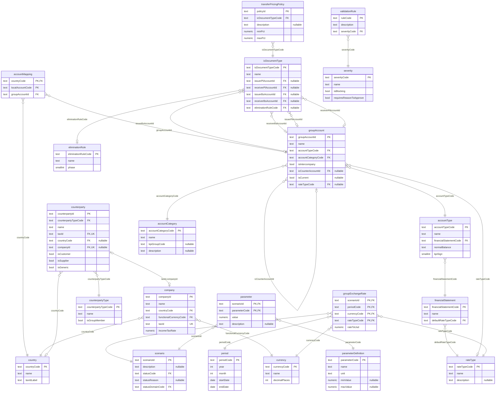
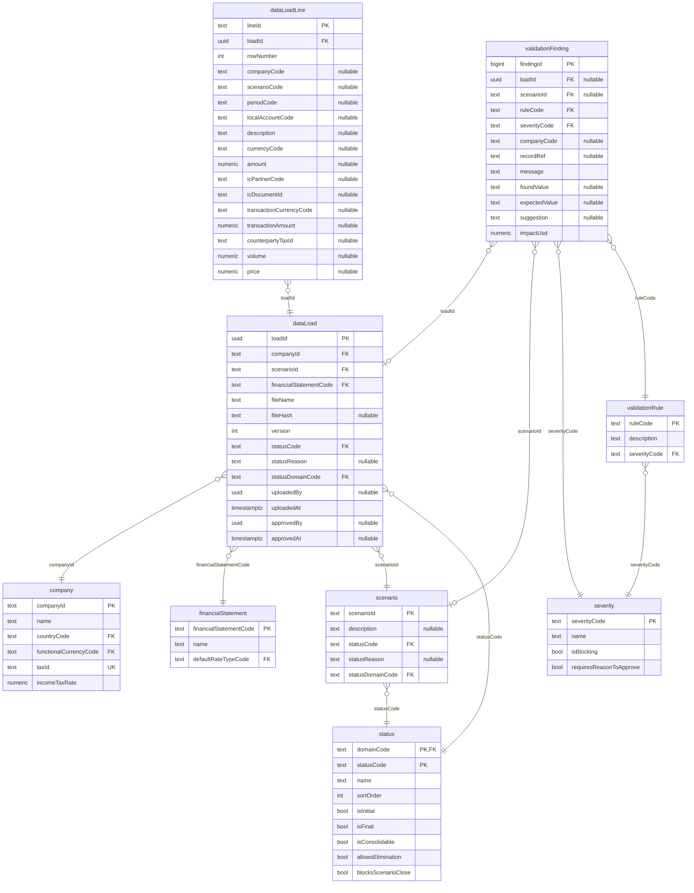
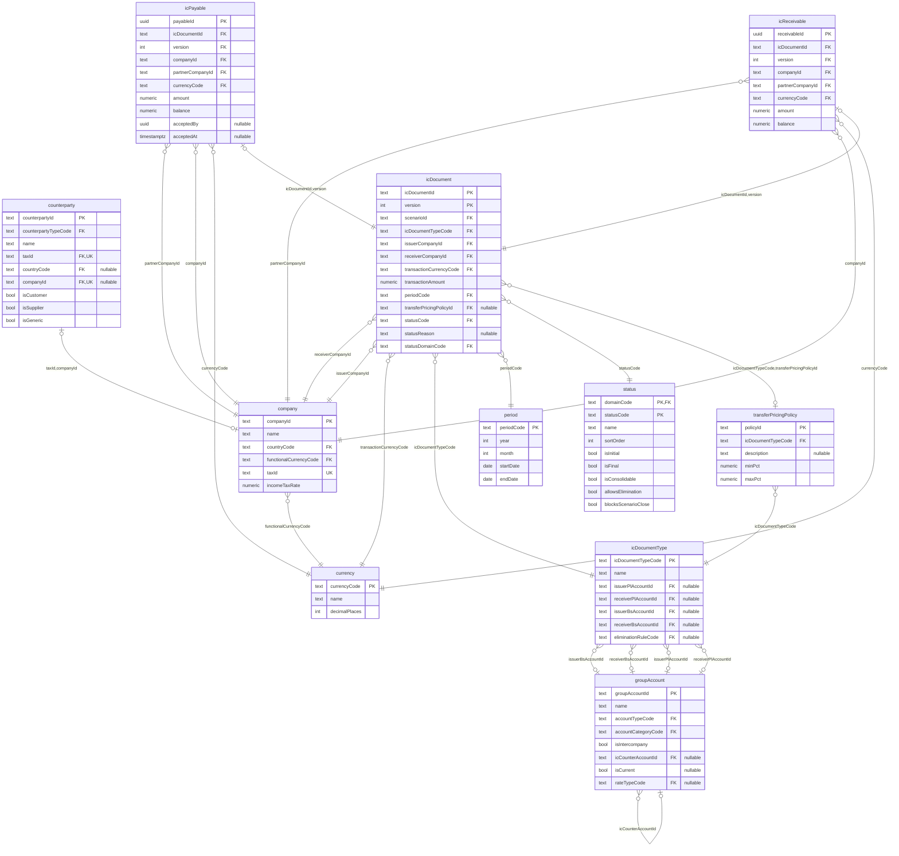
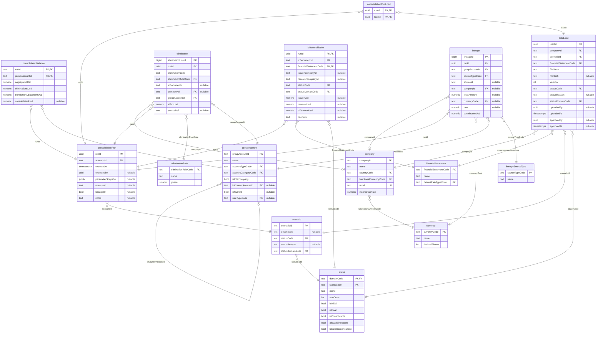
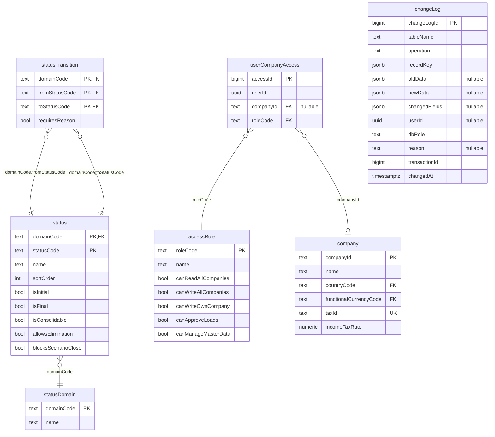

# Diagrama entidad-relación

Generado desde el catálogo de PostgreSQL tras ejecutar `supabase/01_schema.sql` … `05_security_rls.sql` (FKs reales, no dibujadas a mano).
Nombres en inglés, singular y camelCase (en SQL van entre comillas: `"dataLoad"`). Para no saturar, se omiten las columnas de auditoría
`createdAt`, `createdBy`, `updatedAt`, `updatedBy`, `isActive`, presentes en catálogos, maestros e `icDocument`. `changeLog` vive en el esquema `audit`.

Leyenda de columnas: `PK` clave primaria · `FK` clave foránea · `UK` única · `"nullable"` admite nulo.

## 0. Vista general (todas las tablas)

Solo entidades y relaciones. Cada flecha es una FK real; la etiqueta es la columna FK. `}o--||` = muchos a uno obligatorio, `}o--o|` = opcional, `|o--||` = uno a uno.

```mermaid
erDiagram
  accountMapping }o--|| country : "countryCode"
  accountMapping }o--|| groupAccount : "groupAccountId"
  accountType }o--|| financialStatement : "financialStatementCode"
  company }o--|| country : "countryCode"
  company }o--|| currency : "functionalCurrencyCode"
  consolidatedBalance }o--|| consolidationRun : "runId"
  consolidatedBalance }o--|| groupAccount : "groupAccountId"
  consolidationRun }o--|| scenario : "scenarioId"
  consolidationRunLoad }o--|| consolidationRun : "runId"
  consolidationRunLoad }o--|| dataLoad : "loadId"
  counterparty |o--o| company : "taxId,companyId"
  counterparty }o--|| counterpartyType : "counterpartyTypeCode"
  counterparty }o--o| country : "countryCode"
  dataLoad }o--|| company : "companyId"
  dataLoad }o--|| financialStatement : "financialStatementCode"
  dataLoad }o--|| scenario : "scenarioId"
  dataLoad }o--|| status : "statusCode"
  dataLoadLine }o--|| dataLoad : "loadId"
  elimination }o--o| company : "companyId"
  elimination }o--|| consolidationRun : "runId"
  elimination }o--|| eliminationRule : "eliminationRuleCode"
  elimination }o--|| groupAccount : "groupAccountId"
  financialStatement }o--|| rateType : "defaultRateTypeCode"
  groupAccount }o--|| accountCategory : "accountCategoryCode"
  groupAccount }o--|| accountType : "accountTypeCode"
  groupAccount }o--o| groupAccount : "icCounterAccountId"
  groupAccount }o--o| rateType : "rateTypeCode"
  groupExchangeRate }o--|| currency : "currencyCode"
  groupExchangeRate }o--|| period : "periodCode"
  groupExchangeRate }o--|| rateType : "rateTypeCode"
  groupExchangeRate }o--|| scenario : "scenarioId"
  icDocument }o--|| company : "receiverCompanyId"
  icDocument }o--|| company : "issuerCompanyId"
  icDocument }o--|| currency : "transactionCurrencyCode"
  icDocument }o--|| icDocumentType : "icDocumentTypeCode"
  icDocument }o--|| period : "periodCode"
  icDocument }o--|| scenario : "scenarioId"
  icDocument }o--|| status : "statusCode"
  icDocument }o--o| transferPricingPolicy : "icDocumentTypeCode,transferPricingPolicyId"
  icDocumentType }o--o| eliminationRule : "eliminationRuleCode"
  icDocumentType }o--o| groupAccount : "issuerBsAccountId"
  icDocumentType }o--o| groupAccount : "receiverBsAccountId"
  icDocumentType }o--o| groupAccount : "issuerPlAccountId"
  icDocumentType }o--o| groupAccount : "receiverPlAccountId"
  icPayable }o--|| company : "partnerCompanyId"
  icPayable }o--|| company : "companyId"
  icPayable }o--|| currency : "currencyCode"
  icPayable |o--|| icDocument : "icDocumentId,version"
  icReceivable }o--|| company : "partnerCompanyId"
  icReceivable }o--|| company : "companyId"
  icReceivable }o--|| currency : "currencyCode"
  icReceivable |o--|| icDocument : "icDocumentId,version"
  icReconciliation }o--|| consolidationRun : "runId"
  icReconciliation }o--|| financialStatement : "financialStatementCode"
  icReconciliation }o--|| status : "statusCode"
  lineage }o--o| company : "companyId"
  lineage }o--|| consolidationRun : "runId"
  lineage }o--o| currency : "currencyCode"
  lineage }o--|| groupAccount : "groupAccountId"
  lineage }o--|| lineageSourceType : "sourceTypeCode"
  parameter }o--|| parameterDefinition : "parameterCode"
  parameter }o--|| scenario : "scenarioId"
  scenario }o--|| status : "statusCode"
  status }o--|| statusDomain : "domainCode"
  statusTransition }o--|| status : "domainCode,fromStatusCode"
  statusTransition }o--|| status : "domainCode,toStatusCode"
  transferPricingPolicy }o--|| icDocumentType : "icDocumentTypeCode"
  userCompanyAccess }o--|| accessRole : "roleCode"
  userCompanyAccess }o--o| company : "companyId"
  validationFinding }o--o| dataLoad : "loadId"
  validationFinding }o--o| scenario : "scenarioId"
  validationFinding }o--|| severity : "severityCode"
  validationFinding }o--|| validationRule : "ruleCode"
  validationRule }o--|| severity : "severityCode"
```

## 1. Catálogos y datos maestros

Toda columna de código apunta a un catálogo (no hay listas fijas). `counterparty` separa **INTERCOMPANY** (1:1 con `company`, mismo `taxId`) de **THIRD_PARTY**.

## 2. Cargas y validación (staging)

`dataLoadLine` no tiene FKs a catálogos a propósito: recibe archivos malos para que el validador los reporte.

## 3. Intercompany

Un `icDocument` emitido genera en la misma transacción la CxC del emisor (`icReceivable`) y la CxP espejo del receptor (`icPayable`).

## 4. Consolidación

Cada corrida es inmutable: congela parámetros y hash de tasas. `consolidatedUsd` es columna generada (agregado + eliminaciones + CTA).

## 5. Estados, seguridad y auditoría

`status`/`statusTransition` son la máquina de estados genérica (dominios LOAD, IC_DOCUMENT, SCENARIO, RECONCILIATION). `audit.changeLog` es append-only; `userCompanyAccess.userId` apunta a `auth.users` en Supabase.

