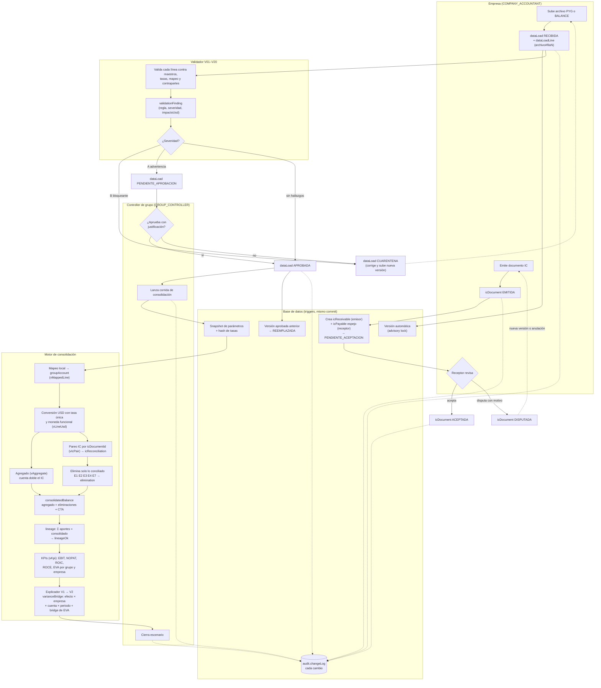
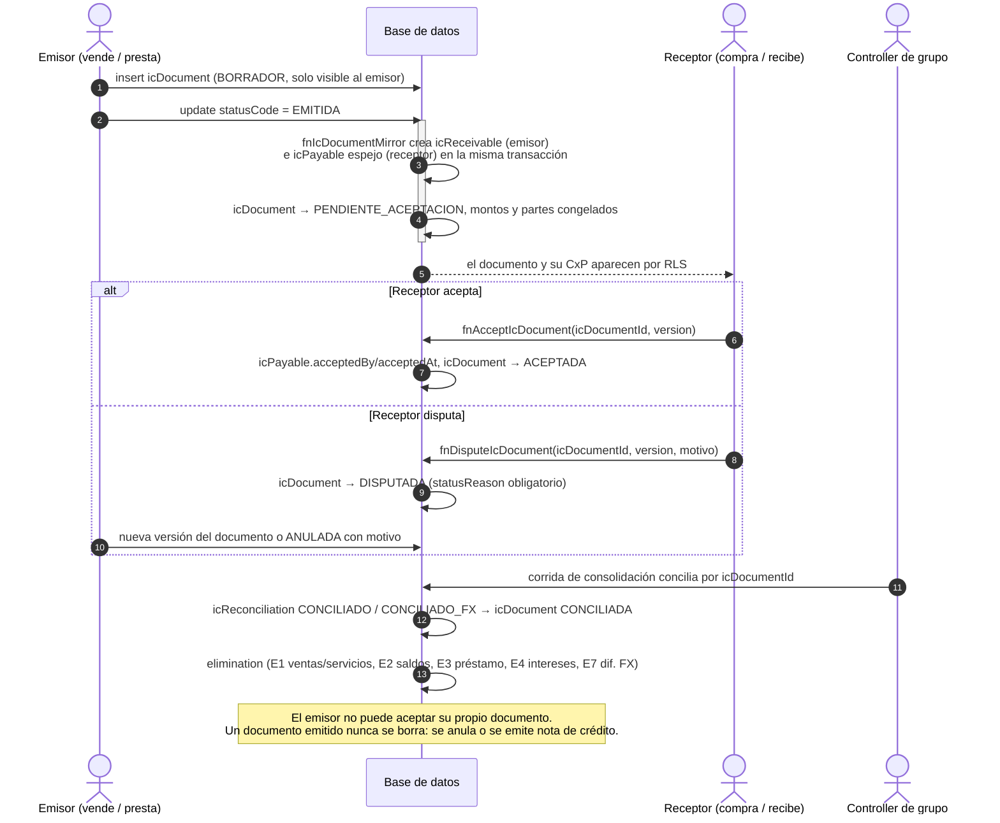
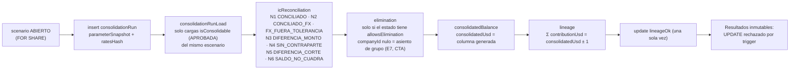
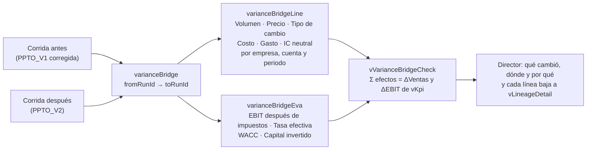
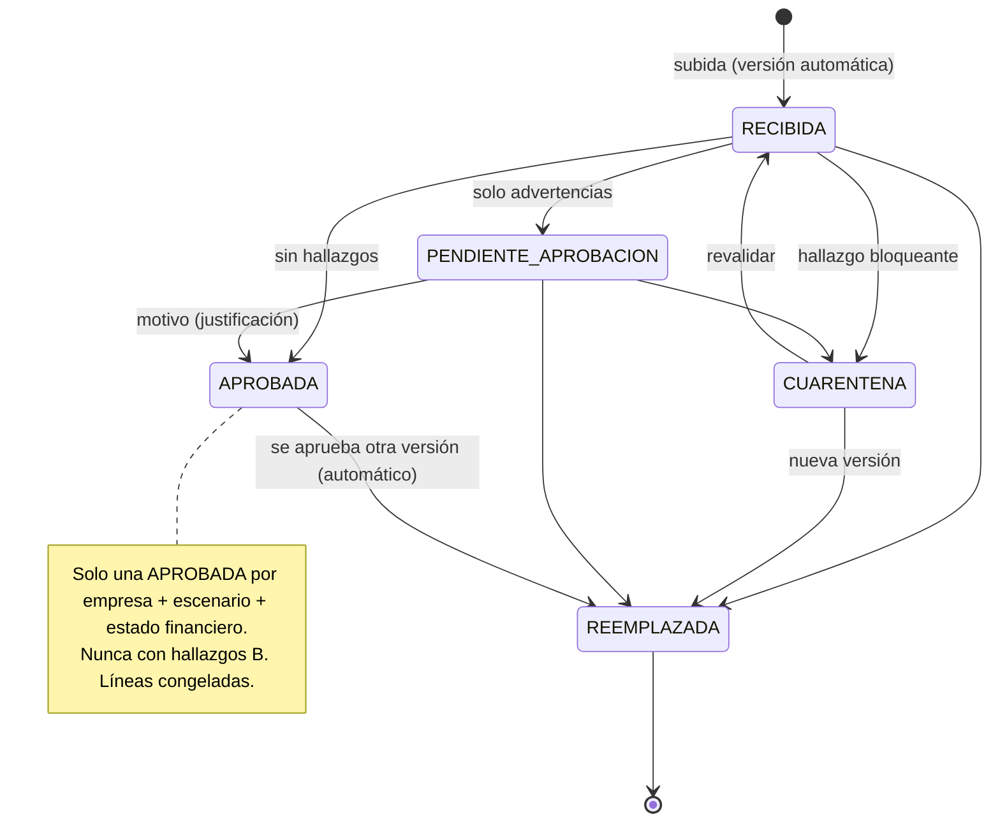
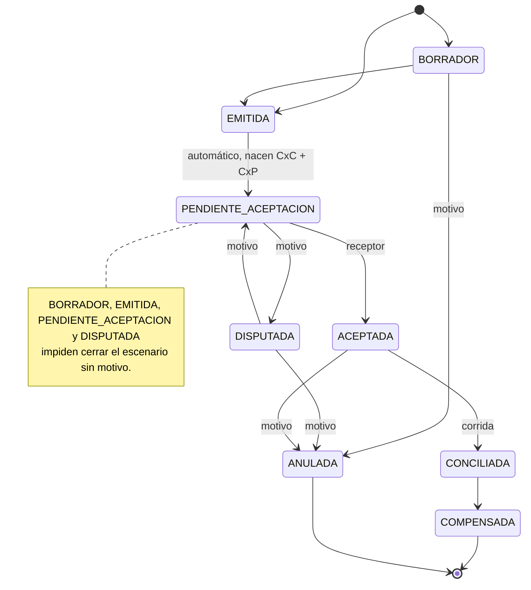
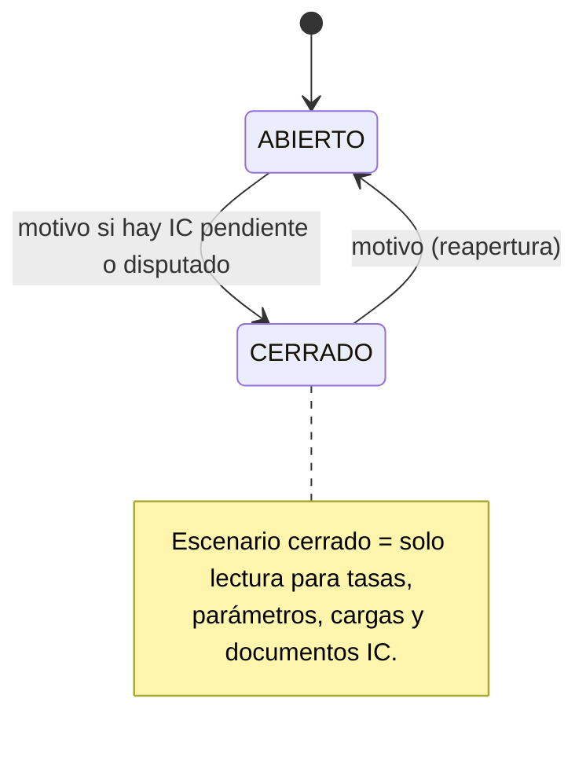

# Diagrama de procesos

Cómo se mueve la información en la base de `supabase/01_schema.sql`: quién hace cada paso, qué tabla toca y qué regla
de la base lo protege. Los estados y transiciones salen del catálogo `"status"` / `"statusTransition"`.

## 1. Proceso de punta a punta

## 2. Ciclo de un documento intercompany

## 3. Corrida de consolidación

## 3b. Explicador de desviaciones

## 4. Máquinas de estado (`"statusTransition"`)

Transiciones marcadas con **motivo** exigen `statusReason` no vacío. Cualquier otra transición la rechaza
`fnEnforceStatusTransition`.

### Carga (`"dataLoad"`, dominio LOAD)

### Documento IC (`"icDocument"`, dominio IC_DOCUMENT)

### Escenario (`"scenario"`, dominio SCENARIO)

## 5. Quién puede hacer qué (RLS, `05_security_rls.sql`)

| Rol | Ve | Escribe | Aprueba cargas | Maestros |
|---|---|---|---|---|
| `GROUP_CONTROLLER` | Todo el grupo, corridas, auditoría | Todo | Sí | Sí |
| `AUDITOR` | Todo el grupo, corridas, auditoría | Nada | No | No |
| `COMPANY_ACCOUNTANT` | Su empresa, sus IC (emitidos y recibidos), su CxC/CxP | Cargas y documentos IC de su empresa | No | No |
| `COMPANY_VIEWER` | Su empresa | Nada | No | No |
| `anon` | Nada | Nada | No | No |

Los borradores IC solo los ve el emisor. `service_role` (backend, SQL Editor) no pasa por RLS.
